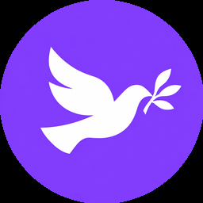

<p align="center">
  
</p>

<h1 align="center">HolubVPN</h1>

<p align="center"><i>Нативный Android-клиент проекта <b>turnvpn</b></i></p>

Приложение на Kotlin поверх `VpnService`: системный VPN перехватывает TCP-трафик
телефона, а [tun2socks](https://github.com/xjasonlyu/tun2socks) отдаёт его в туннель
turnvpn (TURN → DTLS → KCP/smux) до VPS. Go-ядро подключено через gomobile `.aar`.
Общую картину проекта см. в [корневом README](../README.md).

## Сборка

Нужны Android SDK + NDK и [gomobile](https://pkg.go.dev/golang.org/x/mobile/cmd/gomobile).

```sh
# из корня репозитория:
# 1) Go-ядро → android/app/libs/turnvpn.aar
ANDROID_HOME=<путь к SDK> ./scripts/build.sh aar
# 2) APK
cd android && ./gradlew assembleDebug
# готовый файл: android/app/build/outputs/apk/debug/HolubVPN-debug.apk
```

## Запуск

1. Поднять `cmd/server` на VPS (см. [корневой README](../README.md)).
2. В приложении заполнить **VPS host:port**, **общий секрет** (тот же, что на сервере)
   и **ссылку на звонок** (токен из `vk.ru/call/join/...`).
3. **Get token** — откроется страница звонка в WebView; проверку VK «я не робот»
   решает человек, после чего per-call токен подхватывается автоматически.
4. **Connect** — разрешить системный VPN. Кнопка станет зелёной «Connected», в
   статусбаре появится значок VPN.

## Оговорки

- Пока **только arm64**.
- Транспорт — **TCP**. DNS идёт через туннель по TCP автоматически (включать Private
  DNS вручную не нужно); QUIC (UDP) откатывается на TCP.
- Браузерный звонок нужно держать живым, пока VPN поднят.
- Капчу приложение само не решает — это ручной шаг (human-in-the-loop).

## CLI-альтернатива (Termux)

Termux — это Linux-окружение на Android, где можно запустить обычный Linux-бинарник
клиента без приложения:

```sh
./scripts/build.sh android   # → dist/turnvpn-client-android-arm64
```

Бинарник поднимает SOCKS5 на `127.0.0.1:1080`; дальше нужен SOCKS5-совместимый
браузер или приложение. Для большинства случаев проще APK выше.
